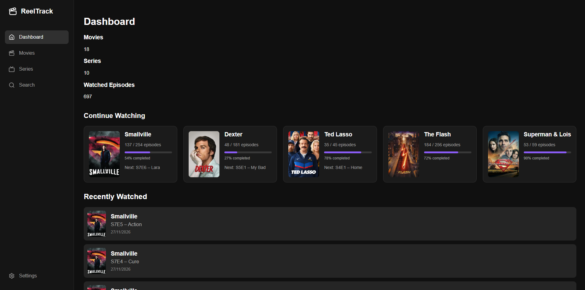
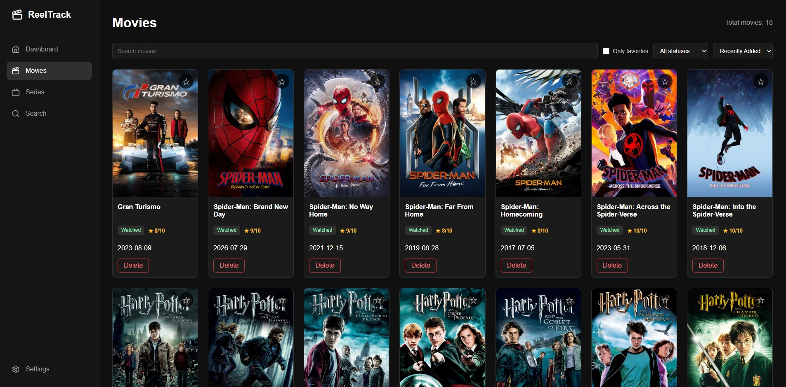
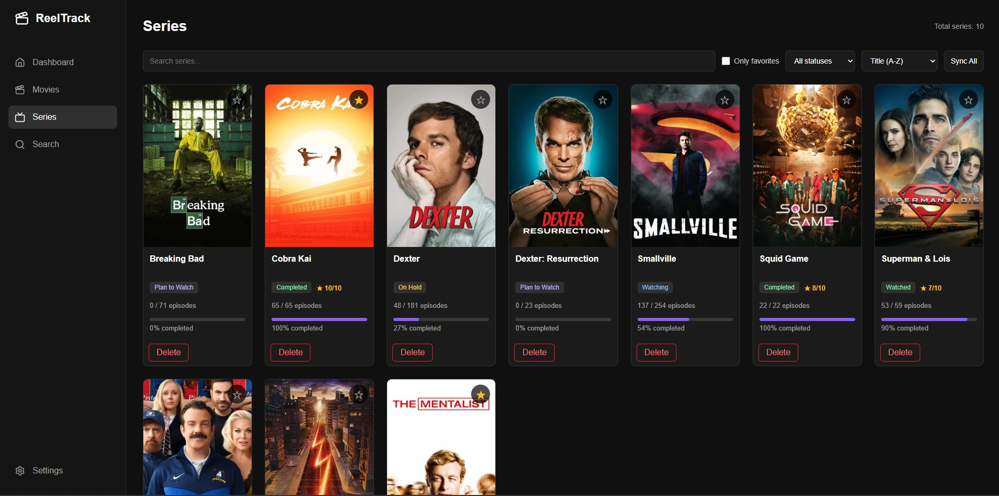
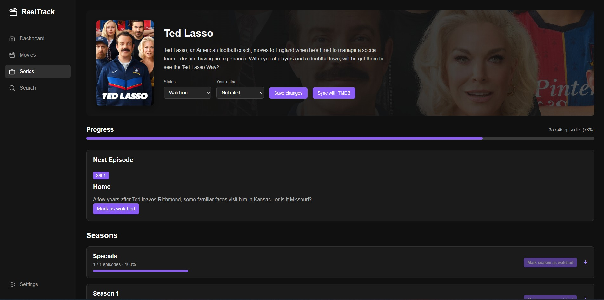
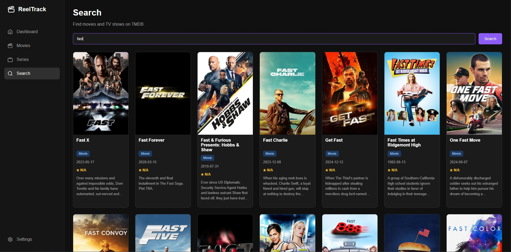

# ReelTrack

ReelTrack is a personal movie and TV series tracking application. It allows users to manage their watchlists, track their progress, rate movies and series, and keep a history of their viewing activity.

The application uses the **TMDB (The Movie Database) API** to retrieve movie and TV series information, reducing the need for manual data entry.

## Technologies

### Frontend
- React
- Vite
- JavaScript
- CSS
- Nginx

### Backend
- C#
- ASP.NET Core Web API
- .NET 10
- Entity Framework Core

### Database
- PostgreSQL 17
- Docker

### External API
- TMDB API

## Features

### Movie Management
- Search for movies using TMDB.
- Import movies with their metadata and images.
- View detailed movie information.
- Track personal watch status:
  - Plan to Watch
  - Watching
  - Watched
  - On Hold
  - Dropped
  - Completed
- Add personal ratings.
- Add and manage viewing history, including multiple watches.
- Mark movies as favorites.
- Search, filter, and sort the movie collection.
- Delete movies from the collection.

### TV Series Management
- Search for TV series using TMDB.
- Import series along with their seasons and episodes.
- View detailed series and episode information.
- Track personal watch status and ratings.
- Mark individual episodes as watched or unwatched.
- Mark an entire season as watched.
- Track overall viewing progress.
- Automatically identify the next unwatched episode.
- Synchronize series information with TMDB.
- Synchronize all series at once.
- Mark series as favorites.
- Search, filter, sort, and manage the series collection.

### Dashboard
- View an overview of the personal media collection.
- Track viewing progress.
- View recent viewing activity.

### Backup and Data Transfer

ReelTrack supports two different backup methods:

- **JSON Export/Import:** Transfer movies, series, and watch history between different ReelTrack installations.
- **Database Backup/Restore:** Create and restore complete PostgreSQL database backups. These backups are signed with installation-specific RSA keys and can only be restored by the installation that created them.

Backup signing keys are generated automatically and stored locally. In Docker deployments, they are stored in a persistent Docker volume. They must never be shared or committed to version control.

## Screenshots

### Dashboard


### Movies


### Series


### Series Details


### Search


## How It Works

ReelTrack follows a client-server architecture.

### 1. Frontend

The React application provides the user interface. Users can browse their collections, search for new movies and series, update their tracking information, and manage their viewing history.

The frontend communicates with the backend through HTTP requests. In the Docker deployment, Nginx serves the built React application and forwards API requests to the backend.

### 2. Backend

The ASP.NET Core Web API handles application logic and database operations.

It is responsible for:
- Processing frontend requests.
- Managing movies, series, seasons, and episodes.
- Saving tracking information.
- Communicating with the TMDB API.
- Synchronizing series metadata and episode information.
- Managing viewing history.
- Creating and restoring database backups.
- Handling JSON data export and import.

### 3. Database

PostgreSQL stores the application's persistent data.

Entity Framework Core is used to communicate with the database.

The database contains information about:
- Movies
- Movie viewing history
- TV series
- Seasons
- Episodes
- Episode viewing history

Database migrations are applied automatically when the backend starts in the Docker deployment.

### 4. TMDB Integration

When a user searches for a movie or series, the backend retrieves matching results from TMDB.

After selecting an item, the user can import it into their collection. The application retrieves the available metadata and stores it in the local database.

For TV series, synchronization can retrieve newly released seasons and episodes and update existing metadata without removing the user's viewing history.

### 5. Docker Architecture

The Docker Compose setup runs three services:

- **PostgreSQL:** Stores application data.
- **Backend:** Runs the ASP.NET Core Web API.
- **Frontend:** Serves the built React application through Nginx and forwards API requests to the backend.

The services communicate through Docker's internal network. Only the frontend is exposed to the host machine by default.

## Project Structure

```text
ReelTrack/
├── backend/
│   └── ReelTrack.Api/
│       ├── Controllers/
│       ├── Data/
│       ├── Dtos/
│       ├── Migrations/
│       ├── Models/
│       ├── Services/
│       └── Dockerfile
│
├── frontend/
│   ├── src/
│   │   ├── components/
│   │   ├── pages/
│   │   └── services/
│   ├── Dockerfile
│   ├── nginx.conf
│   └── vite.config.js
│
├── database/
├── docs/
├── .env
├── .gitignore
└── docker-compose.yml
```

## Requirements

To run the Docker deployment, make sure the following tools are installed:

- Docker Desktop
- Git

A TMDB API key is also required for movie and series search and metadata retrieval.

For local development, the following tools are additionally required:

- .NET 10 SDK
- Node.js and npm

## Configuration

Create a `.env` file in the root project directory.

Example:

```env
POSTGRES_DB=reeltrack
POSTGRES_USER=reeltrack_user
POSTGRES_PASSWORD=your_password
TMDB_API_KEY=your_tmdb_api_key
```

Replace the example values with your own configuration.

The TMDB API key is passed to the backend through an environment variable.

Do not commit the `.env` file, API keys, passwords, or other sensitive configuration files to Git.

## How to Run

### Docker Deployment (Recommended)

The entire application can be started using Docker Compose.

From the main project directory, run:

```bash
docker compose up --build
```

This builds and starts all three services:

- PostgreSQL database
- ASP.NET Core backend
- React frontend served by Nginx

Once the services are running, open the application in your browser:

```text
http://localhost:8080
```

To stop the application, press `Ctrl + C` in the terminal.

To start the application in the background:

```bash
docker compose up -d --build
```

To stop the background services:

```bash
docker compose down
```

The PostgreSQL data is stored in a persistent Docker volume, so stopping or recreating the containers does not delete the database.

**Important:** Do not use `docker compose down -v` unless you intentionally want to remove the persistent volumes and their data.

### Local Development

The application can also be run locally without using Docker for the frontend and backend.

Docker is still used to run PostgreSQL.

#### 1. Start the Database

From the main project directory:

```bash
docker compose up postgres -d
```

#### 2. Start the Backend

Navigate to the backend project directory:

```bash
cd backend/ReelTrack.Api
```

Start the ASP.NET Core API:

```bash
dotnet run --launch-profile https
```

The backend uses the local development configuration, including the database connection string and TMDB API key stored in .NET User Secrets.

#### 3. Start the Frontend

Open another terminal and navigate to the frontend directory:

```bash
cd frontend
```

Install dependencies if necessary:

```bash
npm install
```

Start the Vite development server:

```bash
npm run dev
```

The frontend is available at:

```text
http://localhost:5173
```

During local development, Vite forwards API requests to the local ASP.NET Core backend.

## Current Development Status

ReelTrack is currently under active development.

The current version includes the main movie and TV series tracking functionality, database management, Docker-based deployment, and backup and data transfer features.

An Electron-based desktop application is planned for a future version.

Additional features, improvements, and UI refinements may be introduced in future versions.

## License

This project is licensed under the **PolyForm Noncommercial License 1.0.0**.

You are free to:
- Use the software for personal, educational, and other noncommercial purposes.
- Study and modify the source code.
- Distribute original or modified versions for noncommercial purposes.

Commercial use is not permitted without prior written permission from the author.

For commercial licensing inquiries, please contact the author.

See the [LICENSE](LICENSE) file for the full license terms.

## Third-Party Services and Libraries

ReelTrack uses third-party services, APIs, and open-source libraries. These components are subject to their own licenses and terms of service, which are separate from this project's license.

In particular:

- **TMDB API:** Movie and TV series metadata, posters, and images are provided by The Movie Database (TMDB) and are subject to its terms of use. ReelTrack is not endorsed or certified by TMDB.
- **React:** Used for building the frontend.
- **ASP.NET Core and Entity Framework Core:** Used for the backend and database operations.
- **PostgreSQL:** Used as the application's database system.
- **Docker:** Used to run and manage the application's services.
- **Nginx:** Used to serve the frontend and forward API requests.

The PolyForm Noncommercial License applies only to the original code and materials owned by the ReelTrack author. It does not override the licenses or terms governing third-party components and services.